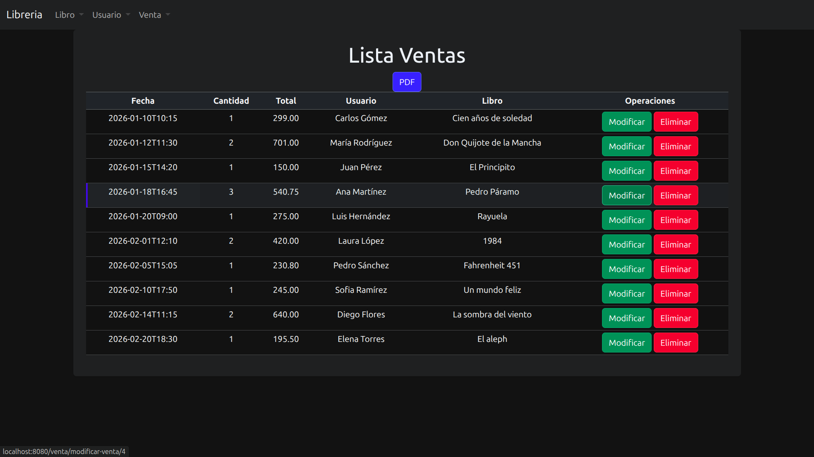
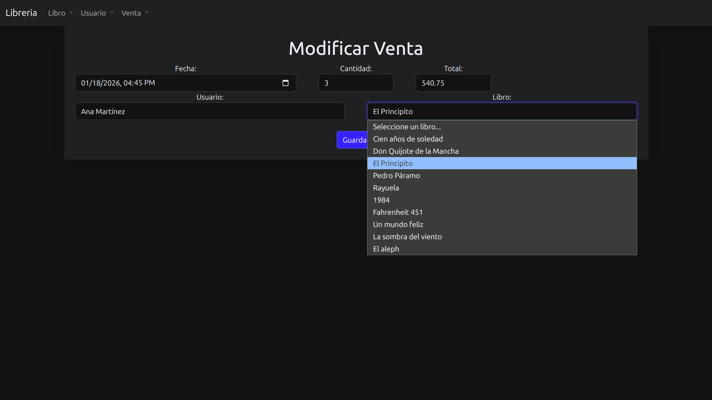

# Sistema de Gestión de Librería y Ventas

Aplicación web hecha con Java 17 y Spring Boot para administrar una librería. Permite manejar el catálogo de libros, los usuarios y las ventas, y también generar reportes en PDF.

El proyecto está organizado en capas y usa Spring Data JPA para guardar la información en una base de datos MySQL.

## Tecnologías

| Tecnología | Uso |
|---|---|
| Java 17 | Lenguaje de programación |
| Spring Boot | Framework principal del backend |
| Spring Data JPA | Persistencia de datos |
| Hibernate | ORM para la base de datos |
| Jakarta Validation | Validación de datos |
| Thymeleaf | Plantillas para las vistas |
| Bootstrap 5 | Estilos de la interfaz |
| MySQL | Base de datos |
| OpenPDF | Generación de PDFs |
| Lombok | Menos código repetitivo |
| Maven | Dependencias y build |

## Arquitectura

El proyecto usa una arquitectura por capas para mantener el código ordenado y fácil de modificar:

- Controllers: reciben las peticiones HTTP y mandan los datos a las vistas.
- Services: tienen la lógica de negocio y manejan las transacciones.
- Repositories: interfaces de Spring Data JPA para consultar y guardar datos.
- Entities: las clases que representan las tablas de la base de datos.
- DTOs: objetos para pasar información entre capas.
- Mappers: convierten entre entidades y DTOs para que la vista no dependa directamente de la persistencia.

## Funcionalidades

### Libros

- CRUD completo (crear, consultar, actualizar y eliminar).
- Datos del libro: título, autor, ISBN, precio y stock.
- Validación de campos.
- Control del inventario.

### Usuarios

- Registro y administración de usuarios.
- Consulta, edición y eliminación.
- Validación de campos obligatorios.

### Ventas

- Registro de ventas relacionando libros y usuarios.
- Cálculo del total de cada venta.
- Manejo de fecha y hora con campos `datetime-local`.
- Consulta y visualización de las ventas.
- Procesamiento de datos con Java Streams.
- Relaciones entre entidades con JPA.

### Reportes PDF

- Exportación de libros, usuarios y ventas.
- Generación de los PDFs con OpenPDF.
- Respuestas HTTP armadas con `ResponseEntity`.
- Descarga de los reportes desde la aplicación.

## Capturas de pantalla

### Lista de ventas


### Formulario de ventas


## Modelo de datos

Se manejan tres entidades:

- Libro: catálogo e inventario.
- Usuario: usuarios registrados.
- Venta: operaciones de venta, que relacionan usuarios con libros.

Las relaciones se definen con anotaciones de JPA (`@OneToMany` y `@ManyToOne`).

## Requisitos

- JDK 17 o superior
- MySQL instalado y corriendo
- Maven, o el Maven Wrapper que ya viene incluido
- Un IDE compatible con Maven y Spring Boot (yo recomiendo IntelliJ IDEA)

## Instalación y ejecución

1. Clona el repositorio:

```bash
git clone https://github.com/tu-usuario/jpa-libreria.git
```

2. Crea la base de datos en MySQL:

```sql
CREATE DATABASE jpa_libreria;
```

3. Configura la conexión en `src/main/resources/application.properties`:

```properties
spring.datasource.url=jdbc:mysql://localhost:3306/jpa_libreria
spring.datasource.username=tu_usuario
spring.datasource.password=tu_contrasena
```

Ajusta también las propiedades de JPA según tu entorno.

4. Ejecuta la aplicación desde la carpeta raíz del proyecto:

```bash
./mvnw spring-boot:run
```

En Windows:

```bash
mvnw.cmd spring-boot:run
```

5. Abre el navegador en:

```text
http://localhost:8080/libro/ver_lista
```

## Objetivo

Hice este proyecto para practicar y aprender el ecosistema de Java y Spring. La idea fue armar una aplicación funcional que junte persistencia de datos, lógica de negocio, arquitectura por capas y generación de documentos.